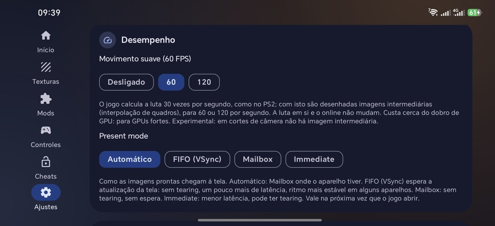
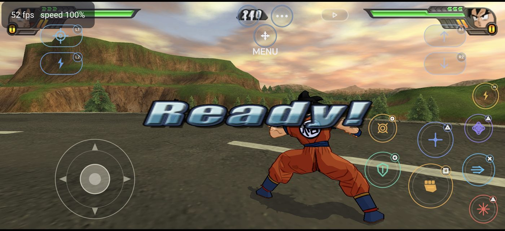

# Dragon Rage 0.4.0

The big one: **online play**, **smooth motion (60/120 pictures a second)**, a **present mode** selector, a **picture that fits your screen**, a rebuilt in-game menu and a handful of quality-of-life features. The engine is now up to date with the latest PC port.

## Highlights

### Online play
- The PC port's online mode now runs on Android: **rollback netplay** with **room codes**. One player hosts and gets a code, the other joins with it. Open it from the main menu entry **Dragon Net Battle**.
- Matchmaking goes through the PC port's service; when two phones cannot reach each other directly, a relay is used.
- This needed the game's state saving and restoring to be written for arm64 (the PC version relied on calls Android does not have).
- First tests are Android ↔ Android. Android ↔ PC has not been verified yet.

### Smooth motion
- The game computes a fight 30 times a second, as on the PS2. With **Smooth motion** on, extra pictures are drawn in between (frame interpolation): **60** or **120** a second. The fight itself, replays and online play do not change.
- It costs about twice the GPU work, so it is meant for strong GPUs. It is **experimental**: at camera cuts there is no in-between picture.
- In the app: **Settings > Performance**. In game: **Video** tab (it also offers 240).

### Present mode
- New selector: **Automatic**, **FIFO (VSync)**, **Mailbox**, **Immediate**. Automatic uses Mailbox where the device has it.
- Chosen in the app, or in the in-game menu, where it takes effect **at once** (no restart).

### A picture that fits your screen
- The picture now takes **the shape of your screen** (the new default, "Screen"), so it is not squashed to 4:3: the fight shows more of the scene to the sides instead of stretching it.
- Fixed shapes are still there: 4:3, 16:10, 16:9, **20:9** (new), 21:9, 32:9. The in-game menu has them all too.

### In-game menu
- Has every option the app has: **Smooth motion**, **Present mode** and the **screen shape** (including Screen and 20:9).
- **START + SELECT** opens and closes it, on a physical controller **and** on the on-screen controller (tap both).
- **Quit to launcher**: leave the game and go back to the app's menu without closing the app by hand.

### Controls
- You can choose between the **game-specific layout** (0.3.0) and the **classic layout** (generic console pad) in **Controls**. Each keeps its own button positions.
- **Automatic menu / fight layout**: the controller shows the menu buttons in the menus and switches to the fight buttons when a fight starts (and back when it ends). The MENU / FIGHT button still works by hand, for the pause menu in a fight for example; it can be turned off in **Controls**.
- The menu-mode buttons no longer carry text (OK, Back, …): only the symbol, a cleaner look.
- **One button in clashes**: in a beam clash or a rush clash, mash **Square** (melee) instead of turning the stick. It works with the on-screen controller and with a physical controller, is on by default and can be turned off in **Controls**.
- New look of the on-screen buttons: translucent, with the action drawn on each one.

### Launcher
- **Play shortcut**: from **Home** you can put a Play icon on the home screen that starts the game directly. The app icon's long-press menu has **Play** too.
- This update window now shows the changelog, formatted, instead of plain text.
- Earlier in this cycle: texture packs can be downloaded inside the app, updates can be installed from GitHub releases without leaving the app, and the About page links to the repository.

## Under the hood
- Brought up to date with the latest PC port: smooth motion, online play, hotkeys, the 2D filtering option and many fixes.
- Closing the game no longer crashes the app's process on exit.
- The watchdog thread and the disc-data check are off on Android by default (less overhead; the app already checks the disc image when it installs it).

## Performance
- Devices with a Mali-G52 are GPU-bound in heavy fights (about two thirds of full speed). Nothing safe was found to change that in this release; it stays on the list.

## Known limits
- Online play is new: expect rough edges, and tell us about desyncs with the log (**Settings > Save log**).
- Smooth motion is experimental and needs a strong GPU.
- The in-game menu is still in English.

## Upgrade notes
- It installs over the previous version and keeps your game data, settings and saves.
- The app still needs your own disc image of the USA release (SLUS-21678); this release does not distribute game data.
