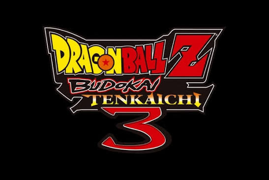

<p align="center">
  
</p>

<p align="center">
  <b>Dragon Ball Z: Budokai Tenkaichi 3, running natively on Android.</b><br>
  An Android port of <a href="https://github.com/z3xox/Tenkaichi3Decomp">Tenkaichi3Decomp</a>, the native PC port built on the BT3 decompilation.
</p>

<p align="center">
  <a href="../../releases"></a>
  <a href="../../actions/workflows/android.yml"></a>
  
</p>

---

> [!IMPORTANT]
> **Status: the whole game runs natively on Android arm64**: menus and full battles at the game's full 30 fps on
> Snapdragon (AYN Odin 3, Odin 2 Mini, Snapdragon 8s Gen 4) and on recent Mali GPUs (Dimensity 8400, Unisoc T820).
> Online play with room codes, smooth motion (60/120), HD texture packs (`.dds` and `.png`), Vulkan or OpenGL ES
> (automatic for Mali), an on-screen controller made for this game, screen filters (FXAA, AMD FSR 1, Snapdragon GSR)
> and custom Adreno drivers are in. Next: weaker GPUs, quality-of-life features. See [Roadmap](#roadmap).

This repository contains **no game data**. You need your own copy of the **USA release (SLUS-21678)** as an
`.iso`. The app reads it on your device; nothing is downloaded or uploaded.

## What it is

The PC port is not an emulator: it is the game's own code, decompiled and compiled for PC, with a new renderer,
sound and input layer underneath. Dragon Rage brings that to Android in two parts:

| Part | Where | State |
|---|---|---|
| **Launcher app** (Kotlin, Jetpack Compose, Material 3; English and Portuguese) | [`android/`](android) | ✅ Done |
| **Game engine** (the port's C code, built for arm64 as `libbt3.so`) | `src/`, `include/`, `port/` | ✅ Runs on Snapdragon and Mali phones and handhelds; weaker GPUs being tuned |

## The app

<table>
<tr><td><b>Home</b></td><td>Pick your ISO. The app checks it is the USA release (the same SHA-1 checks as the PC setup; a translated or modded image installs too, with a warning) and copies the game data in the layout the engine expects. Play button, and a <b>Play shortcut</b> for the home screen that starts the game directly.</td></tr>
<tr><td><b>Textures</b></td><td>Import a texture pack as a <code>.zip</code>, or download one from inside the app (a list kept in <a href="android/texture-packs.json"><code>android/texture-packs.json</code></a>, or any direct link to a <code>.zip</code>), or copy its folder into <code>textures/</code>. Packs made for PCSX2 (<code>.dds</code> / <code>.png</code>) work as they are: <code>.dds</code> files are unpacked for phones' GPUs, which cannot read DXT. Turn each pack on or off, or all of them at once.</td></tr>
<tr><td><b>Mods</b></td><td>File-replacement mods as <code>.zip</code> (with a priority order), extra stages (<code>.unk</code>) and extra songs (<code>.adx</code>), with the name shown in the game's menus editable.</td></tr>
<tr><td><b>Cheats</b></td><td><i>Unlock everything</i>: every character, stage, song and item, and max Zeni. This is the debug function the developers left in the game. It is applied the next time the game starts.</td></tr>
<tr><td><b>Controls</b></td><td>The on-screen controller for playing without a gamepad: a <b>layout made for this game</b> (its own actions: target, Ki, melee, guard, dash, blasts, ultimate, team swap) with a menu mode that switches <b>by itself</b> between menus and fights, or the <b>classic</b> console pad; PlayStation, Xbox or Nintendo look, layout editor (move, resize, hide), macros (combos, several buttons at once, turbo), opacity, size, vibration, floating stick. <b>One button in clashes</b> (mash Square instead of turning the stick). Also reachable in game.</td></tr>
<tr><td><b>Settings</b></td><td>Renderer (<b>Vulkan</b> or <b>OpenGL ES</b>; automatic: OpenGL ES on Mali), internal resolution 1x–8x in fine steps (1.25x, 1.5x, 1.75x … for weaker GPUs), screen filter (bilinear, sharp bilinear, FXAA, AMD FSR 1, Snapdragon GSR), picture shape (the screen's own, or 4:3 to 32:9), <b>smooth motion</b> (60 or 120 pictures a second), present mode (FIFO, Mailbox, Immediate), each of the five PS2 effects (outline, see-through tint, depth tint, glow, distance blur), glow strength, music / voice volume, custom GPU driver for Adreno (Turnip and others, through AdrenoTools), <i>Save log to Downloads</i> for bug reports, theme, Material You colours.</td></tr>
<tr><td><b>In game</b></td><td>The game's own menu (back button, START + SELECT, or the on-screen MENU button): every setting above, <b>Dragon Net Battle</b> (online play with a room code), and <b>Quit to launcher</b>.</td></tr>
</table>

Dark theme with Dragon Ball colours (Goku's gi orange and blue, dragon-ball amber, Super Saiyan gold) by default,
or your wallpaper's colours with Material You. On wide screens (handhelds like the AYN Odin) the navigation moves
to a side rail.

### Install

Download `DBT3-<version>.apk` from the [latest release](../../releases/latest) and install it. A newer
version installs over the older one and keeps your game data, settings and saves.

- **Releases** (`android-vX.Y.Z` tags): tested versions.
- **[Nightly](../../releases/tag/android-nightly)**: the latest build of `main`, for testing; may be broken.

The app checks GitHub when it opens and offers new versions: it downloads the APK and hands it to Android's installer (it asks for "install unknown apps" the first time). A test build follows the nightly, a normal build follows the releases.

To report a problem: *Settings → Save log to Downloads*, then send the `DBT3-log-….txt` file.

Build it yourself:

```sh
sh port/tools/android_toolchain.sh   # LLVM 21, the NDK's sysroot, SDL3 (once)
python3 port/tools/android.py        # the engine -> android/app/src/main/jniLibs
cd android && ./gradlew assembleRelease   # needs JDK 17+ and the Android SDK (compileSdk 35)
```

### Where files go

Everything lives in `Android/data/com.bytarch.dbt3/files/`, in **the same layout the PC port uses next to
its program**, so the engine will run with that folder as its working directory without Android-specific paths:

```
gamedata/            the disc's files (disc/SLUS_216.78, disc/BIN/, disc/DATA/ with the AFS archives, .installed)
gamedata/mods/       replaced files (rebuilt by the app from modlib/)
textures/            active texture packs (any depth)      textures_off/   packs switched off
stages/  songs/      extra stages and songs (maps.txt / songs.txt hold the menu names)
saves/               memory card
bt3_settings.txt     engine settings (name=number lines)
modlib/              the app's mod library
```

New keys in `bt3_settings.txt` for the Android side: `dr_unlock_all` (1 = run the unlock once at start, then reset to
0), `dr_renderer` (0 automatic, 1 Vulkan, 2 OpenGL ES; the app writes the engine's `gpu_api` from it). The on-screen
controller's settings, layout and macros are in `touch_controls.json`. Online play uses **`https://dbt3-server.bytarch.com`**
and nothing else: that address is compiled into the game, and there is no file in the game folder that can point
it somewhere else (see `port/matchmaking/`, and `VPS.md` for the service this build expects). Dragon Net Battle has
two ways to find the other player: a room code you tell each other, or quick match, where the service pairs you
with whoever is waiting for a match on the same release.

## Roadmap

### Done
- [x] Launcher app: game-data install from ISO with checksum verification, texture packs, mods, extra
      stages and songs, unlock-all cheat, all engine settings, Material 3 theme, English and Portuguese
- [x] CI: every push builds the APK ([android-nightly](../../releases/tag/android-nightly)); an `android-vX.Y.Z` tag
      publishes a versioned release
- [x] Engine builds for arm64 (332 of 332 sources), loads below the Java heap, and **boots and plays**: memory card
      check, logos, opening movie, menus, character select and battles on the AYN Odin 3 (Snapdragon 8 Elite), at
      the game's full 30 fps, about 2–3 W at 4x resolution
- [x] Worked around an LLVM 21 AArch64 bug: byte/halfword stores through 32-bit pointers were emitted as 4/8-byte
      stores (`irfix.py` routes them through an ordinary pointer)

### Since then
- [x] **Fast install**: the AFS archives are copied whole and read through their tables (no more ~20 000 small files)
- [x] **Modified ISOs** (translations such as PT-BR, mods such as "Tenkaichi 4"): installed with a warning; the
      engine takes their data. Changes a mod made to the game's *code* do not apply (the engine is the original
      program, rebuilt)
- [x] In-game menu: the game **pauses** while it is open, works with **touch**, fills the screen, every setting of the
      app, **Quit to launcher**; the back button and **START + SELECT** open it
- [x] **On-screen controller** made for this game (0.3.0), automatic menu / fight layout, the classic pad as an option,
      one button in clashes, layout editor, macros, three looks (0.4.0)
- [x] **Mali GPUs**: Vulkan without the optional features Mali lacks, shaders without `discard` where nothing is
      discarded, render targets a quarter of the size; **OpenGL ES 3.2** renderer, automatic on Mali (0.5.0)
- [x] **Engine loads anywhere in the low 4 GB** (relocatable), for devices whose Java heap sits where the engine used
      to go (Moto g100 and others)
- [x] **Custom GPU drivers** for Adreno (Turnip, newer Qualcomm drivers) through AdrenoTools
- [x] **Screen filters**: bilinear, sharp bilinear, FXAA, AMD FSR 1 (EASU + RCAS), Snapdragon Game Super Resolution;
      internal resolution in fine steps
- [x] **In-app update** from GitHub releases with the changelog, and **texture pack download** inside the app
- [x] **Smooth motion** (frame interpolation to 60/120 pictures a second), **present mode** selector, picture shaped to
      the screen (0.4.0)
- [x] **Online play** with room codes and rollback, from the PC port (0.4.0)
- [x] **HD texture packs** in `.dds` on phones' GPUs (unpacked on the CPU), a memory budget for the cache, a sturdier
      import (0.5.0)
- [x] Back from the background without a black screen; the log says the speed and where the frame time goes (0.5.0)

### Next
- [ ] **Weaker GPUs** (Mali-G52, Mali-G68, Adreno 610): fewer render passes and copies in the renderer; compare Vulkan
      and OpenGL ES on them
- [ ] Online play: our own matchmaking service (the PC port's has daily limits), Android to PC
- [ ] In-game menu in Portuguese
- [ ] Picture: anisotropic filtering, SMAA, more post-processing shaders
- [ ] Quality-of-life features of a "definitive edition" (the game's code is all here to change)
- [ ] Pause the game while the app is in the background

## Repository layout

| Path | Contents |
|---|---|
| `android/` | **Dragon Rage**, the Android app (Gradle project) |
| `src/`, `include/` | The game's code, from the decompilation; PC changes are inside `#ifdef PORT` |
| `port/` | The PC port: platform layer, renderer, sound, input, build tools |
| `docs/` | Notes on the game and on the PC port ([the PC port's original README](docs/port/upstream_README.md)) |

## Credits

- **[Tenkaichi3Decomp](https://github.com/z3xox/Tenkaichi3Decomp)** by z3xox: the native PC port this is built on,
  and the matching decompilation BT3-Decompiled under it. Contributors of the PC port are listed in its README.
- Dragon Rage (Android app and port): [dfdx047](https://github.com/dfdx047).
- [AMD FidelityFX Super Resolution 1](https://github.com/GPUOpen-Effects/FidelityFX-FSR) (MIT),
  [Snapdragon Game Super Resolution](https://github.com/SnapdragonStudios/snapdragon-gsr) (BSD-3-Clause),
  [libadrenotools](https://github.com/bylaws/libadrenotools) (BSD-2-Clause), [SDL3](https://libsdl.org) (zlib).
- Made with the help of AI.

## Licence

The Android app (`android/`) and the PC port's own code (`port/` except `port/third_party/`) are under the
[MIT licence](LICENSE). The libraries in `port/third_party/` and the shaders in `port/src/gs/shaders/ffx/` (FSR's
headers) and `port/src/gs/shaders/sgsr.frag` keep their own licences (the files next to them). The game's code in `src/` and
`include/` comes from the decompilation and belongs to the game's rights holders.

## Legal

This project is not affiliated with or endorsed by the game's developers, publishers or rights holders. It exists
for preservation, study and interoperability, and distributes none of the game's assets. Dragon Ball and all
related names belong to their owners. You need your own legally obtained copy of the game.
